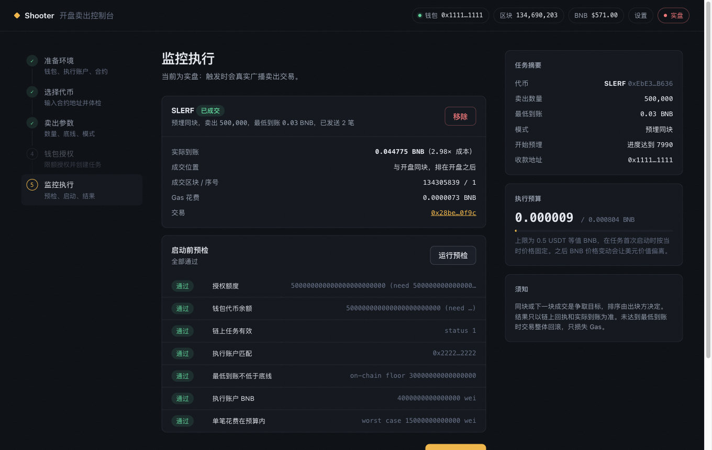
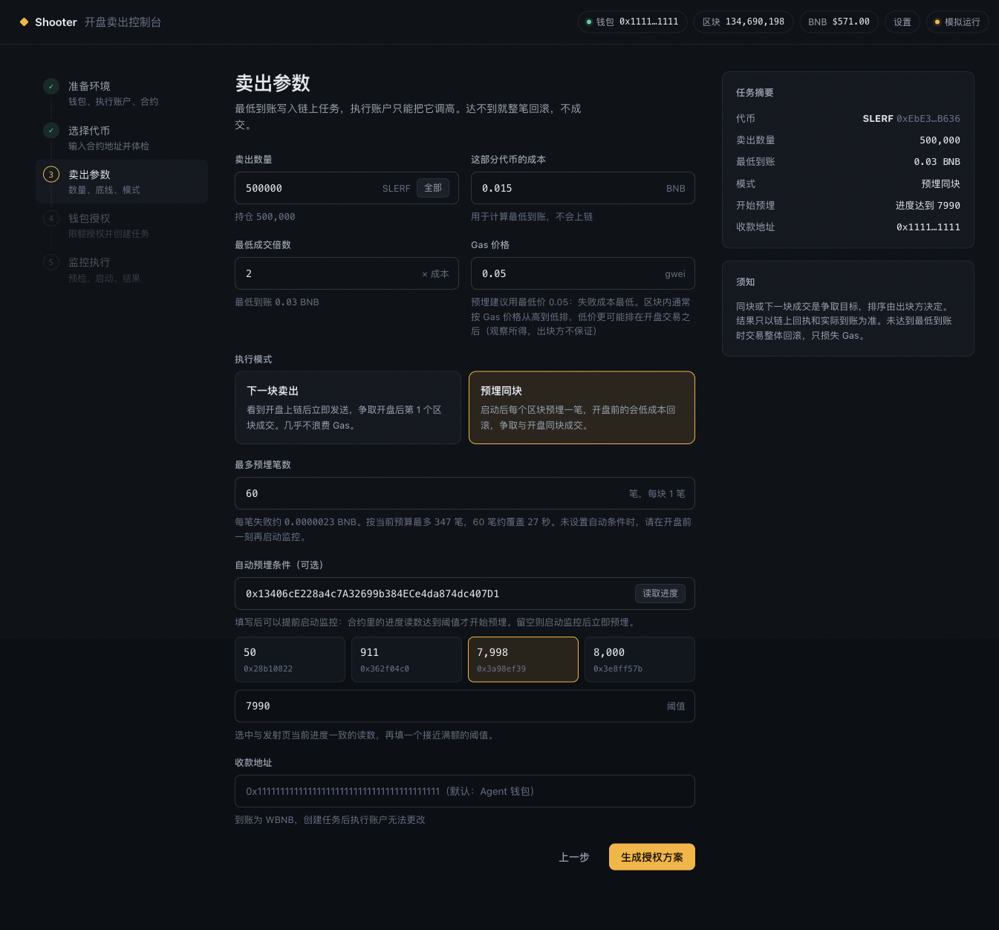
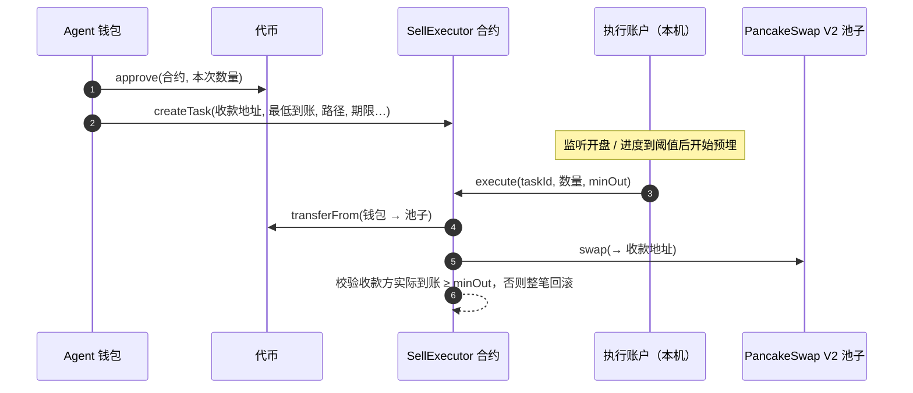

<div align="center">

# Shooter

**BNB Smart Chain 开盘自动卖出框架**

代币留在你的 Binance Agentic Wallet，开盘瞬间由受约束的合约代卖，所得直接回到你的钱包。

[](https://github.com/gunksd/shooting/actions/workflows/ci.yml)
[](LICENSE)
[](https://www.bnbchain.org)
[](shooter/)
[](contracts/src/SellExecutor.sol)
[](contracts/test/)
[](#测试与验证)
[](https://github.com/gunksd/shooting/commits/main)

[快速开始](#快速开始) · [使用步骤](#使用步骤) · [工作原理](#工作原理) · [实测结果](#测试与验证) · [常见问题](#常见问题)



</div>

> [!WARNING]
> **不保证同块或下一块成交。** 区块内的交易顺序由出块方决定。"发送成功""拿到哈希"都不算成交，结果只按链上回执、区块位置和实际到账判断。下文所有数字都来自主网分叉复现，主网实盘命中率还没有数据。

## 特性

- **不交出私钥**：钱包只做两步操作，限额授权和创建任务，都先经钱包模拟再由你确认。
- **合约强制的权限**：收款地址、数量上限、最低到账、路径全部写入链上任务，执行方改不了。达不到最低到账时整笔回滚。
- **钱可以取回**：执行账户只放少量 BNB 付 Gas，一键全额转回钱包。合约不留任何余额。
- **两种执行模式**：「预埋同块」争取与开盘同块、排在开盘之后；「下一块卖出」在开盘上链后立即发送。
- **硬性 Gas 预算**：每个任务默认 0.5 USDT，每笔交易签名前就预留最坏花费，超出就不发。
- **本地控制台**：五步向导完成全部操作，默认模拟运行，切实盘需要二次确认。

## 快速开始

需要：macOS 或 Linux，[Node.js 22+](https://nodejs.org)，[Rust](https://rustup.rs)，[Git](https://git-scm.com)，以及一个 Binance Agentic Wallet（持有要卖的代币，并有少量 BNB 付授权和建任务的 Gas）。

```bash
# 1. 钱包 CLI，然后用 Binance Wallet App 扫码登录
npm i -g @binance/agentic-wallet
baw auth signin

# 2. 拉代码，编译并启动控制台
git clone --recurse-submodules https://github.com/gunksd/shooting.git
cd shooting
./scripts/setup.sh
```

浏览器打开 **http://127.0.0.1:4780**。第一次编译要几分钟。

<details>
<summary>开机自启、常驻后台（macOS）</summary>

```bash
./scripts/service-macos.sh install     # 登录后自动启动，崩溃后自动重启
./scripts/service-macos.sh status      # 查看状态
./scripts/service-macos.sh logs        # 查看日志
./scripts/service-macos.sh uninstall   # 卸载
```

常驻的只有控制台。服务重启后监控保持关闭，需要你在页面上手动启动，避免意外进入实盘。内存占用实测：控制台约 60 MB，监控运行时另加约 15 MB，CPU 低于 1%。

</details>

<details>
<summary>手动安装（不用脚本）</summary>

```bash
git submodule update --init --recursive
(cd shooter && cargo build --release --locked)
node console/server.mjs              # 端口可用 PORT=xxxx 修改
```

不需要安装 Foundry，部署用的合约字节码已随仓库提交（`contracts/artifacts/SellExecutor.json`，CI 会校验它与源码一致）。

</details>

<details>
<summary>需要代理才能访问币安或 RPC 时</summary>

`baw` 和控制台都是 Node 程序，Node 默认不读取 `HTTPS_PROXY`。控制台检测到 `HTTPS_PROXY` 后会自动加上 `NODE_USE_ENV_PROXY=1`，单独运行 `baw` 时请自己加：

```bash
export HTTPS_PROXY=http://127.0.0.1:7890
NODE_USE_ENV_PROXY=1 baw wallet status
```

</details>

## 使用步骤

控制台把整个流程分成五步，左侧导航显示进度。



### 1. 准备环境

| 操作 | 说明 | 花费 |
|---|---|---|
| 检测钱包 | 自动读取 Agent 钱包的 BSC 地址 | 无 |
| 生成执行账户 | 在本机生成一个只用来付 Gas 的新账户，私钥存于 `data/executor.key`（权限 0600） | 无 |
| 转入 BNB | 从任意钱包向执行账户转约 **0.004 BNB** | 转账费 |
| 部署执行合约 | 由执行账户部署一次，以后所有任务复用 | 约 0.0028 BNB |

> [!TIP]
> 执行账户里的 BNB 随时可以点「取回 BNB」全额转回 Agent 钱包，只扣一笔转账费。请备份好 `data/` 目录，删掉 `executor.key` 后里面的余额就取不回了。

### 2. 选择代币

粘贴代币合约地址，点「体检」。控制台会读取符号、你的持仓、PancakeSwap V2 池子状态。持仓为 0 时不能继续。

### 3. 卖出参数

| 参数 | 怎么填 |
|---|---|
| 卖出数量 | 默认全部持仓 |
| 成本 | 你买这部分代币花的 BNB，只用来计算最低到账，不上链 |
| 最低成交倍数 | 例如 2 表示至少卖到成本的 2 倍，否则不成交 |
| Gas 价格 | 预埋模式建议 0.05 gwei（BSC 最低值） |
| 执行模式 | 见下表 |
| 自动预埋条件 | 可选。填发射合约地址并点「读取进度」，选中与发射页一致的进度数字，再填阈值（例如 8000 份里的 7990）。达到阈值才开始预埋，可以提前挂着 |
| 收款地址 | 默认 Agent 钱包，到账为 WBNB |

| 模式 | 什么时候发 | 目标 | 代价 |
|---|---|---|---|
| **预埋同块** | 启动后（或进度到阈值后）每个区块发一笔 | 与开盘同块，排在开盘之后 | 开盘前的每笔都会回滚，每笔约 0.0000023 BNB |
| **下一块卖出** | 看到开盘上链后立即发 | 开盘后第 1 个区块 | 几乎不浪费 |

### 4. 钱包授权

两笔交易都由你的 Agent 钱包发出，每笔先显示钱包模拟结果，确认后才上链：

1. **限额授权**：只授权本次要卖的数量。
2. **创建链上任务**：把收款地址、最低到账、路径固定在合约里。

### 5. 监控执行

点「运行预检」，确认授权、余额、任务、执行账户资金全部通过，再点「启动」。

右上角默认是 **模拟运行**：触发时只签名并记录，不广播。确认无误后点它切换到 **实盘**，需要二次确认。成交后页面显示实际到账、倍数、成交区块和块内序号。

## 工作原理



**合约约束**（[`SellExecutor.sol`](contracts/src/SellExecutor.sol)，256 行）

- 不可升级、没有管理员、没有任意调用、没有救援函数。
- 只有任务创建者能修改或取消。执行方只能选择不超过上限的数量，和不低于底线的最低到账。
- 成功一次后任务结束，失败则整笔回滚、任务保留。
- 实际卖出量按余额差计算，最低到账按收款地址的真实余额变化校验。
- `taskId` 绑定链 ID、合约地址、创建者和序号，不存在跨链或跨合约重放。

**Rust 引擎**（[`shooter/`](shooter/)）负责监听开盘、签名、按预算发送、读取回执、处理重组和重启恢复。控制台（[`console/`](console/)）是零依赖的本地 Node 服务，只监听 127.0.0.1。

<details>
<summary>两种卖出路径与转账税</summary>

| 路径 | 代币转账次数 | 说明 |
|---|---|---|
| `DirectToPair`（控制台默认） | 1 次：钱包 → 池子 | 合约按池子实际收到的数量计算输出并调用 `pair.swap`，仅支持单跳 |
| `RouterHop` | 2 次：钱包 → 合约 → 池子 | 走 Router，支持多跳和原生 BNB 到账，转账税会被收两次 |

`maxTransferLossBps` 默认 0，即只接受无损耗转账的代币，遇到税币会回滚并保留任务。

</details>

<details>
<summary>Gas 预算规则</summary>

- 每任务默认 0.5 USDT，在任务首次启动时按 Pancake V2 的 BNB/USDT 价格换算成固定的 BNB 上限，留 5% 缓冲。之后 BNB 涨跌会让它的美元价值偏离。价格过期或不合理时拒绝启动。
- 每笔交易签名前预留 `gasLimit × gasPrice`，预留不下就不发，任务停止。
- 同一 nonce 的替换交易按互斥计；不同 nonce 累加。
- 失败的交易按回执实际花费入账；超时的交易在确认结局前保持预留。
- 预算有剩余不会被主动花掉。
- 部署合约属于初始化费用，单独记账。授权和创建任务由 Agent 钱包支付。

</details>

## 测试与验证

```bash
cd contracts && forge test        # 31 项合约测试
cd shooter && cargo test          # 37 项：单元、引擎行为、anvil 端到端
BSC_ARCHIVE_RPC=<归档节点> python3 scripts/fork_replay.py   # 主网分叉全流程
```

**主网分叉复现**：在 SLERF 开盘前一个区块（134305832）的真实状态上，用编译好的程序走完部署、授权、建任务、启动，然后原样重放真实的开盘交易。卖出 50 万枚，成本 0.015 BNB：

| 模式 | 成交位置 | 到账 | 倍数 | 发送笔数 | 卖出 Gas |
|---|---|---|---|---|---|
| 预埋同块 | 与开盘同块，紧跟其后 | 0.04478 BNB | 2.985x | 2（1 笔开盘前回滚） | 146,010 |
| 下一块卖出 | 开盘后第 1 块 | 0.04478 BNB | 2.985x | 1 | 190,694 |

取回 BNB 同样验证过：余额全额转出，剩余 0 wei。

> [!NOTE]
> 分叉上的块内排序由本地节点按 Gas 价格决定。主网上，SLERF 当时唯一与开盘同块卖出的地址预埋了 4 笔，只有 1 笔排在开盘之后。主网同块命中率是概率性的。

**为什么要抢这几个区块**（SLERF 主网真实数据，倍数 = 卖出均价 ÷ 成本）：

| 区块 | 开盘块 | +1 | +2 | +3 | +4 | +8 |
|---|---|---|---|---|---|---|
| 首笔 → 末笔 | 2.99x | 2.96x → 2.61x | 2.58x → 2.37x | 2.35x → 2.11x | → 1.49x | 1.06x → 1.01x |

BSC 每 0.45 秒出一个块，开盘块之后能卖到 2 倍以上的时间约 1.35 秒。

## 兼容性

| 类型 | 状态 |
|---|---|
| 标准 ERC-20，PancakeSwap V2，WBNB 交易对 | ✅ 支持 |
| 开盘前锁定转账、开盘后放开（SLERF 类） | ✅ 支持，主网分叉验证 |
| 无返回值代币（USDT 风格） | ✅ 支持，限 DirectToPair |
| 固定比例转账税 | ⚠️ 需设置损耗上限，RouterHop 会双重计税 |
| 限制合约地址、黑名单、最大交易量、冷却时间 | ⚠️ 需要逐币验证，命中时交易回滚、任务保留 |
| 反射、rebasing、动态税代币 | ❌ 不支持 |
| PancakeSwap V3、发射台内盘、其他 DEX | ❌ 不支持，代码里留了扩展接口 |

## 常见问题

<details>
<summary><b>转进执行账户的 BNB 能取回吗？</b></summary>

能。第一步页面上点「取回 BNB」，全部余额转回你的 Agent 钱包，只扣一笔约 0.000001 BNB 的转账费。命令行：`shooter --config data/shooter.toml withdraw <你的地址>`。

</details>

<details>
<summary><b>没卖到最低到账会怎样？</b></summary>

那笔交易整体回滚，代币仍在你的钱包里，只损失这笔交易的 Gas。任务保持有效，下一个区块继续尝试，直到成交、达到笔数上限或预算用完。

</details>

<details>
<summary><b>怎么彻底取消一个任务？</b></summary>

在第五步点「移除」会停止本地监控，并给出一段取消数据。用钱包把它发给执行合约即可在链上取消，或者把代币授权额度改回 0。已经发出的交易无法撤回。

</details>

<details>
<summary><b>为什么一开始默认是模拟运行？</b></summary>

模拟运行下，程序在触发时只签名并记录，不广播任何交易，用来确认任务配置和触发时机都正确。实盘需要你在右上角手动切换。

</details>

## 命令行

控制台底层调用的就是这个程序，也可以单独使用：

```bash
shooter --config config.toml preflight         # 预检
shooter --config config.toml run               # 启动监控，Ctrl-C 停止
shooter --config config.toml status            # 状态（JSON）
shooter --config config.toml cancel <taskId>   # 本地停止并打印链上取消数据
shooter --config config.toml withdraw <地址>    # 取回执行账户 BNB
```

配置说明见 [`config.example.toml`](config.example.toml)。守护进程也可以用 Docker 跑：`docker compose up`。

## 项目结构

| 路径 | 内容 |
|---|---|
| [`contracts/`](contracts/) | 执行合约、Foundry 测试、部署脚本 |
| [`shooter/`](shooter/) | Rust 引擎与命令行 |
| [`console/`](console/) | 本地网页控制台 |
| [`scripts/`](scripts/) | 安装脚本、主网分叉验收脚本 |
| [`docs/feasibility.md`](docs/feasibility.md) | 可行性调查：钱包、代币、builder 通道、数据源，附来源 |

## 开发状态

- **已实现并测试**：执行合约，V2 开盘识别，三种执行模式，Gas 预算，本地签名与 nonce 管理，SQLite 持久化与重启恢复，回执判定与重组处理，控制台。
- **已实现、主网未验证**：经真实钱包的部署、授权、建任务全流程（主网分叉已通过），主网同块与下一块命中率，48 Club 和 BlockRazor 私有通道，基于 pending 交易的严格同块模式。
- **未实现**：builder 小费，私有订单流竞价，V3 与发射台内盘，多 RPC 自动切换。

## 许可证

[PolyForm Noncommercial License 1.0.0](LICENSE)：允许个人学习、研究、自用和非营利用途，**禁止任何商业用途**，包括出售、收费托管或作为付费服务的一部分。商业授权请联系作者。

## 免责声明

本项目是实验性软件，按 [PolyForm Noncommercial 1.0.0](LICENSE) 许可证原样提供，不提供任何担保。链上交易不可撤销，开盘交易风险很高，可能因排序、税费、代币合约限制或软件缺陷而亏损。实盘前请先用模拟运行和小额验证，并自行审阅合约代码。
